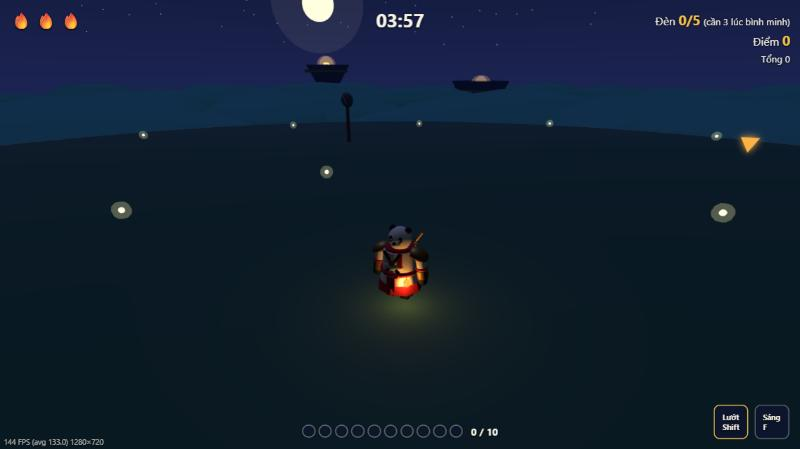

# Đảo Đèn Lồng

> **Video demo:** _chưa có. Cần quay một phiên chơi thật (xem [docs/notes/phase-4.md](docs/notes/phase-4.md))_ · Đề bài lab: [LAB.md](LAB.md)
> Ly Thanh Lap · 2A202603414 · Day 12 AI SDLC · **v1.0.0** · Test Contract **v1.3**



Game 3D góc nhìn thứ ba (Three.js). Mây, người giữ đèn nhỏ tuổi (một chiến binh gấu trúc), đi qua **3 đêm**: Đảo Bến, Đảo Cau, Đảo Chuông. Mây gom đom đóm để thắp và **châm dầu** cho các Đèn Lồng Lớn, giữ đảo sáng tới bình minh, né Bóng Mực và Gió Lạc. Toàn bộ luật là một mô phỏng tất định (`src/sim/`), dùng chung cho bản chơi và chế độ headless.

## Yêu cầu hệ thống

- **Node.js ≥ 22** (macOS, Linux hoặc Windows) và một trình duyệt có WebGL2 (Chrome, Edge, Firefox, Safari mới).
- `npm ci` tải thêm Chrome for Testing (Puppeteer) để chạy benchmark.
- Đã đo: 114–137 FPS trung bình ở 1280×720 trên laptop Ryzen 5 5500U với GPU tích hợp (xem [bench](#benchmark-và-soak)).

## Cài đặt và chơi (3 lệnh)

```bash
git clone https://github.com/lythanhlap/K5-L3A-DAY12-LyThanhLap-2A202603414-AI-SDLC-Dao-Den-Long.git && cd K5-L3A-DAY12-LyThanhLap-2A202603414-AI-SDLC-Dao-Den-Long
npm ci && npm run build
npm start
```

`npm start` (= `node scripts/serve.mjs`) mở http://localhost:8080. Thêm `?seed=42` để cố định thế giới, `?fps` để hiện bộ đếm FPS.
Bản phát hành `v1.0.0` có sẵn file zip `dist/`, xem phần [Release](#release).

## Điều khiển (đổi được hết trong Cài đặt)

| Mặc định | Hành động |
|---|---|
| `W A S D` | Di chuyển theo hướng camera |
| `Space` | Nhảy |
| `Shift` | Lướt (14 m/s trong 0,2 s, hồi 1,5 s) |
| `E` | Nạp ánh sáng vào đèn tắt, hoặc châm dầu cho đèn đang sáng (≤ 2 m) |
| `F` / click chuột | Tỏa Sáng: tốn 3 đom đóm, làm choáng và đẩy Bóng Mực trong 5 m |
| Kéo chuột / `←` `→` | Xoay camera |
| `Esc` | Tạm dừng (Tiếp tục / Chơi lại Đêm / Cài đặt / Về menu) |

**Cài đặt** (được lưu):
- Âm lượng, độ nhạy chuột, gamma.
- Bảng màu dễ phân biệt (mù màu).
- Phụ đề và chỉ báo hình ảnh: Bóng Mực xuất hiện kèm mũi tên ở mép màn hình, gió sắp thổi, 10 giây cuối, đèn dưới 30 dầu.
- Giảm chuyển động: tắt rung camera và chớp màn hình.
- Chữ lớn ×1.25 (chữ mặc định ≥ 18 px).
- Đổi phím, có báo trùng phím và nút "Khôi phục mặc định".
- **Chế độ dễ** (mặc định tắt): 70 đom đóm lúc đầu, sinh thêm 3 con mỗi giây, tối đa 100. Luật chuẩn và headless không đổi.

## Luật và điểm

Luật hiện hành theo Ticket-03; quyết định thiết kế ở [ADR-0001](docs/adr/0001-lantern-fuel-and-dawn-win.md).

- **Thắng:** còn sống khi hết giờ (4:00 / 4:30 / 5:00) và số đèn đang sáng ≥ 3/5, 4/6, 5/7. Hết lửa thì thua ngay.
- **Đèn có dầu** 0–100, hao 1/giây. Châm dầu +10 mỗi đom đóm. Hết dầu thì tắt; thắp lại cần 5 đom đóm (lần đầu cần 10). Đèn dưới 30 dầu mất vùng an toàn 6 m và bị Bóng Mực tìm tới **hút dầu**.
- **Sức chứa** `10 + 2 × số lần thắp`, tối đa 20.
- Có thêm Gió Lạc cướp đom đóm, Bùa Gió tăng tốc, gió mạnh ở Đêm 3, lướt, rơi khỏi đảo.
- **Điểm:** +5 mỗi đom đóm nạp, +100 thắp lần đầu, +40 thắp lại, +5 mỗi Bóng Mực trúng Tỏa Sáng (+15 nếu nó đang hút dầu). Khi thắng: +50 + floor(dầu) mỗi đèn sáng, +50 mỗi lửa.
- **Bảng xếp hạng** (top 10, lưu tại `data/leaderboard.json`): nhập tên sau màn Bình Minh hoặc khi thua; xem từ menu.

## Test, headless, benchmark, soak

```bash
npm test                                   # 123 test: luật, bản đồ, 31 scenario headless (chạy 2 lần so từng byte), contract, bảng xếp hạng, bench scene, soak
npm run proof -- phase-4                   # sinh docs/proof/phase-4/RESULTS.md từ CLI thật
node src/headless.js --seed 1 --night 2 --ticks 600 --out out/run.jsonl [--scenario f.json] [--inputs f.json] [--snapshot-every 10]
node scripts/bench.mjs --seed 42 --duration 30 --out bench.json          # mở cửa sổ Chrome 1280×720 thật, vsync tắt
node --expose-gc scripts/soak.mjs --seed 7 --nights 10 --out soak.json   # 10 đêm trong một tiến trình
node scripts/serve.mjs --export-leaderboard out.json                      # {"entries":[...]} đúng thứ tự
```

### Benchmark và soak

Kết quả thật trên máy của tôi; máy chấm sẽ khác. Log thô và phân tích ở [docs/proof/phase-4](docs/proof/phase-4/) và [phase-4.md](docs/notes/phase-4.md).

| | Kết quả | Ngưỡng |
|---|---|---|
| avg_fps / p1_low_fps / load_ms | **114.1 / 47.3 / 3891** (lần đo lại: 136.9 / 70.3 / 2991) | ≥ 60 / ≥ 30 / ≤ 10000 → đạt |
| peak_mem_mb | 615.9 (cả cây tiến trình Chrome) | — |
| soak crashes | **0** | = 0 → đạt |
| soak mem_start → mem_end | **43.9 → 57.2 MB (×1.30)** | ≤ ×1.2 → **chưa đạt** |

Về soak: JS heap đứng yên qua 40 đêm, nên đây không phải rò rỉ. Phần RSS tăng là mã JIT của V8 (với `--jitless` chỉ ×1.03). Mình giữ cấu hình Node mặc định và ghi kết quả thật.

- **vsync:** tắt bằng cờ Chrome `--disable-gpu-vsync --disable-frame-rate-limit`.
- **Máy không có màn hình:** thêm `--headless` (khi đó số đo không đại diện).

## Release

GitHub Release `v1.0.0` đính kèm `dao-den-long-v1.0.0-web.zip`, gồm `dist/` (bản web tĩnh) cùng server nhỏ để có bảng xếp hạng trên đĩa:
- Giải nén rồi chạy `node scripts/serve.mjs` (cần Node 22, không cần `npm ci`).
- Hoặc phục vụ thư mục `dist/` bằng bất kỳ static server nào. Khi đó bảng xếp hạng lưu trong trình duyệt.

## Kiểm chứng và tài liệu

- **Theo phase:** giả định, tiêu chí nghiệm thu, đánh giá ở [phase-1](docs/notes/phase-1.md), [phase-2](docs/notes/phase-2.md), [phase-3](docs/notes/phase-3.md), [phase-4](docs/notes/phase-4.md).
- **Thay đổi và kết quả:** [ADR](docs/adr/), [CHANGELOG](CHANGELOG.md), [retro](docs/notes/retro.md).
- **Bằng chứng:** `docs/proof/phase-N/` (RESULTS.md sinh tự động, output `.jsonl`, ảnh chụp).
- **CI** (GitHub Actions) chạy test, proof và build trên Ubuntu và macOS mỗi lần push.

## Harness AI

| Thành phần | Dùng khi |
|---|---|
| [AGENTS.md](AGENTS.md) (+ [CLAUDE.md](CLAUDE.md)) | Lệnh, cấu trúc, quy ước tất định, quy tắc đúc kết từ các lần AI sai |
| Hook `Stop` → [stop-gate.mjs](scripts/hooks/stop-gate.mjs) | Không cho agent kết thúc khi `npm test` đỏ |
| Hook `PreToolUse` → [guard-proof.mjs](scripts/hooks/guard-proof.mjs) | Chặn sửa tay `docs/proof/` |
| Skill [headless-proof](.claude/skills/headless-proof/SKILL.md) | Thêm scenario cho một yêu cầu và sinh lại bằng chứng |
| Subagent [contract-reviewer](.claude/agents/contract-reviewer.md) | Review độc lập trước khi tag (Phase 2: tìm ra 3 lỗi thật) |

Nhật ký dùng AI và token: [ai-log](docs/notes/ai-log.md), [retro](docs/notes/retro.md).

## Sáng tạo của tôi

- **Mây là chiến binh gấu trúc đội nón lá** ([character.js](src/web/character.js)). Đèn lồng nhỏ treo ở vành nón như PRD-0, sáng dần theo số đom đóm mang theo. Áo `#E8E2D0`, khăn và quai nón `#C8102E` theo bảng màu chuẩn; có giáp vai đồng, dây chéo, kiếm trong vỏ (chỉ trang trí). Xem mẫu ở `/character.html`.
- **Bối cảnh đêm** ([backdrop.js](src/web/backdrop.js)): vòm trời chuyển màu, 1 400 ngôi sao, trăng có quầng, biển mây trôi, 10 đảo nổi có đèn lồng. Tắt trong cảnh benchmark.
- **Đảo được trang trí** ([decor.js](src/web/decor.js)): thông, cây cau (Đêm 2), trụ đá (Đêm 3), đá, cỏ, hoa; sương trôi và cánh hoa rơi. Không chắn lối, không va chạm, tắt trong benchmark.
- **Chuyển động mượt:** nội suy hình ảnh giữa các tick 60 Hz. Đo được 0 khung giật ở 144 Hz, trước đó 58%.
- **Thanh gamma** trong Cài đặt.

Tất cả chỉ nằm trong `src/web/`, nên output headless không đổi (`npm test` xanh).

## Cấu trúc

```
src/sim/          luật game thuần, tất định (game.js, maps.js, tuning.js)
src/headless.js   CLI theo Test Contract
src/leaderboard.js luật bảng xếp hạng (dùng chung web + CLI)
src/web/          renderer Three.js, HUD, UI, âm thanh, bối cảnh
scripts/          serve (run_cmd), bench, soak, proof, hooks
scenarios/        scenario/inputs + index.json (kỳ vọng tính tay)
tests/            node:test
docs/             notes, ADR, proof
```
